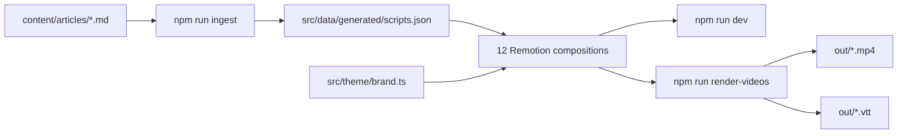

# Short-form video engine

A campaign plan for William Joseph, and the Remotion pipeline that produces it. The audience is digital leads, marketing directors, communications managers and CEOs at UK charities and foundations. The tone is friendly, expert and peer to peer. Every film helps someone make a better decision. None of them show a face.

The live site is the brand system. Tokens in `src/theme/brand.ts` were read from `main-f5e876e7c7.css` on 20 October 2026.

## Brand system

| Role | Token | Where it appears on the site |
| --- | --- | --- |
| Ink | `#1e1e1e` | Headings, footer, focus text |
| Charcoal | `#464646` | Body headings, buttons |
| Cream | `#f9f4eb` | Home hero |
| Cream deep | `#fcf7ee` | About and testimonial bands |
| Mist | `#f0f0f2` | Work and journal bands |
| Yellow | `#ffdd00` | Keyboard focus |
| Aqua | `#67e5e1` | Newsletter, filters, link accent |
| Teal | `#005c66` | Page header, testimonials, how we work |
| Purple | `#4b287a` | Homepage gradient |

Type on the site is Figtree for headings and the hero, IBM Plex Sans for navigation and buttons, and PT Serif for long reading. Films use Figtree and IBM Plex Sans. Serif at caption size is harder to read while type is moving, so PT Serif stays in the token file and off the frame.

Buttons on the site are square. Devices, chips and the URL block in these films are square too. Circles are reserved for the people, processes and tools diagram, which is how that model was drawn in the content series.

Text never uses a raw hex. A beat names a locked pair such as `inkOnCream` or `whiteOnTeal`. The pair is refused at startup if it is under 4.5:1. Decorative bands use a second site colour and never carry type. The URL block picks a locked pair for that accent, so yellow gets ink and teal gets white.

Safe area is 80px at the sides and 108px at the top. The bottom 176px is a permanent caption bar: white IBM Plex Sans on ink, the footer colour, at about 16:1.

## Editorial rules, enforced in the ingest

1. Headings, kickers and list items are sentence case.
2. Ampersands are refused, including in post copy and alt text.
3. “Whilst” is refused. The word is “while”.
4. The name is William Joseph, never WJ.

`npm test` runs these rules against every article. A film outside 30–60 seconds is refused as well.

Reading time is 150 words per minute. Words on screen at once are added together. The caption is the same thought for silent autoplay, so only caption words that are not already on screen extend the hold. Nothing is shorter than 3 seconds after a 12-frame settle. Reduced motion removes the settle and keeps the hold.

## Who it is for, and the three pillars

Primary channel is LinkedIn, in 1080×1350 and 1080×1080. The same files go to Instagram feeds and Bluesky. Do not crop in a face, a stock photo or a client screenshot. Case-study films are abstract: type, numbers and a flat device.

| Pillar | Job | Films |
| --- | --- | --- |
| Practical advice | A micro-guide someone can use this week | Seven barriers, 59.8s. Charity rebrands, 41.9s |
| Data and insight | One or two sourced numbers, then a decision | Public attitudes to AI, 42.4s. Digital maturity, 44.8s |
| Case study | Impact without a portrait | Paul Hamlyn Foundation, 43.2s. BookTrust, 37.2s |

Post copy and alt text live in each article’s `meta` block. Alt text is required on LinkedIn, Instagram and Bluesky. Say that the film is motion graphics and that there are no photographs of people.

## How a film moves through Trello

The board stays `Content ideas` → `In draft` → `Ready for feedback` → `Ready to publish`. Video does not get a separate board.

**Content ideas.** One card per film. Pillar, audience, source URL on williamjoseph.co.uk, and a sentence-case working title. No script yet.

**In draft.** Write `content/articles/<id>.md`. Run `npm run ingest` and `npm run check`. Open the square and portrait compositions in `npm run dev`. Fix anything the contrast, editorial or timing checks refuse. The card stays here until both formats play without a cut under 3 seconds.

**Ready for feedback.** Render both formats, plus a `--reduced-motion` cut if the reviewer needs it. Attach the MP4, the `.vtt`, the post copy and the alt text. Reviewers check four things: the claim matches the source article, the heading is sentence case, captions can be read with the sound off, and the frame still looks like the website.

**Ready to publish.** Approved square and portrait files, alt text, and a link back to the essay or case study. Publish on LinkedIn first. Then the same files, with the same alt text, on Instagram and Bluesky.

Suggested weekly rhythm: one card enters In draft, one sits in Ready for feedback, one is Ready to publish. That is enough. Quality over volume.

## The six films

Each line below is a beat. The caption is what the burned-in bar says. Durations include the reading hold.

### 1. Seven barriers to creating a content-led culture

Pillar: practical advice. 59.8 seconds. Source: Yasmin Georgiou, 16 July 2025.

1. Title. Seven barriers to creating a content-led culture.
2. A strategy only sticks when the culture does. Move people, processes and tools together.
3. Diagram. Content culture lives in the overlap of people, processes and tools.
4. Shared understanding. Co-create what content means for your organisation.
5. Relationships. Group people by what they need, not by job title.
6. Common goals. Name what you share, and where you truly differ.
7. Ways of working. Design the process while you write the strategy.
8. Skills and capabilities. Make time to practise, not only to read.
9. Audience insight. Start small, then let the evidence make the case.
10. Measurement. Set goals everyone can see, and talk about them often.
11. Close. Start with one honest conversation.

### 2. Why charity rebrands are different

Pillar: practical advice. 41.9 seconds. Source: Ed Risbey, 7 July 2025.

1. Title. Why charity rebrands are different.
2. You are among peers, not rivals. Partners, patrons and the people you serve come first.
3. 80% of the sector is small and micro charities.
4. Spend the money well. A rebrand should help the mission. If it cannot, pause.
5. Bold is welcome. Looking wasteful is not.
6. Accessible does not mean ugly. Contrast, type and structure are the brand.
7. Empower the team. If the team cannot use the brand, it will not last.
8. Close. Root it in mission, people and audiences.

### 3. What the public actually thinks about AI

Pillar: data and insight. 42.4 seconds. Source: Ada Lovelace Institute and the Alan Turing Institute survey, as published on the William Joseph case study. More than 4,000 adults in Britain.

1. Title. What the public actually thinks about AI.
2. 4,000+ adults in Britain took part in the survey.
3. People are broadly positive. They are also highly specific.
4. 9 in 10 find AI for cancer detection broadly beneficial.
5. 56% worry about replacing professional judgement.
6. People want regulation. That view is not the same in every age group.
7. Close. Design for nuance, not a single opinion.

### 4. Digital maturity is a practice, not a score

Pillar: data and insight. 44.8 seconds. Source: Yasmin Georgiou, 25 May 2023. The 12% and 4× figures are from the Salesforce Nonprofit Trends report, as cited in that essay.

1. Title. Digital maturity is a practice, not a score.
2. Quote. Reaching digital goals that are linked to organisational goals.
3. 12% of not-for-profits describe themselves as digitally mature.
4. 4× more likely to achieve their mission goals.
5. Device. Three building blocks: five to seven categories, a vision of what good looks like, a matrix from now to future.
6. Plot now, next and future. Levels run from 1 to 5, across the whole organisation.
7. High numbers can still be fragile. Strong performance can hide an unsustainable culture.
8. Close. Make the model fit the organisation.

### 5. Paul Hamlyn Foundation

Pillar: case study. 43.2 seconds. Abstract only. No grant figures were invented.

1. Title. A brand that feels like the relationship.
2. The identity lagged behind the mission. Warm, long-term relationships were not yet visible.
3. We started with both sides of the table. Grantees and the team shaped a shared mission language.
4. Device. Fund finding, in plain language: who it is for, how much it awards, how long it lasts, when you can apply.
5. A finder should remove a barrier. It should never get in the way.
6. Built to be used, not only admired.
7. Close. Bold and colourful. Highly accessible.

### 6. BookTrust

Pillar: case study. 37.2 seconds. The book figure is the one published on the case study: over 3 million free books a year.

1. Title. A website for the people who get children reading.
2. 3 million+ free books shared with families each year.
3. The audience had shifted. Professionals who support families are now the focus.
4. Device. Who we listened to: teachers, librarians, health visitors, social workers, early years professionals.
5. Families still need a front door. A clear path for professionals, and one for parents and carers.
6. Insight before interface. Research was trauma-informed. People were partners in the work.
7. Close. Design from what people need.

Access to Justice Foundation is the next case-study card, not a seventh film in this set. Same pattern: the barrier the old identity created, the plain-language job of the new site, no invented metrics, no portraits.

## Technical architecture



| Path | Responsibility |
| --- | --- |
| `src/theme/brand.ts` | Site colours, type stacks, layout, locked pairs |
| `src/theme/contrast.ts` | WCAG 2.2 relative luminance |
| `src/theme/motion.tsx` | `prefers-reduced-motion`, overridable by a render prop |
| `src/lib/editorial.ts` | Sentence case, ampersand, whilst, WJ |
| `src/lib/timing.ts` | 150 words per minute and the 3 second floor |
| `src/lib/parse-article.ts` | Markdown to composition props |
| `src/components/` | Kinetic type, quote card, data callout, vector device, Venn, captions |
| `src/compositions/InsightVideo.tsx` | One player for every script, both formats |
| `scripts/render-videos.ts` | Bundles once, then writes H.264 and WebVTT |

Each script is registered twice: `CompositionIdSquare` at 1080×1080 and `CompositionIdPortrait` at 1080×1350, 30fps. Beats are hard cuts. A crossfade would put type on a colour it was not checked against.

Components:

- **KineticType** settles a whole statement in 12 frames. It does not reveal word by word, because the reading clock starts when the full line is visible.
- **QuoteCard** is a Figtree statement with a geometric quote mark.
- **DataCallout** is a figure, a label and a source line in the same contrast pair.
- **VectorDevice** is a square browser frame. Rows are flat type, never a screenshot.
- **CaptionTrack** is always on, in the same place, on ink.

## Distribution notes

LinkedIn is silent for most viewers, so the caption bar is the soundtrack. Keep post copy shorter than the film: one decision, then the link to the essay. Do not restate all seven barriers in the post when the film does that.

Instagram uses the same 4:5 and 1:1 files. Do not switch these to a face-led Reel. Bluesky needs the alt text from the meta block pasted into the post.

File names from the renderer:

```text
out/seven-barriers-square.mp4
out/seven-barriers-square.vtt
out/seven-barriers-portrait.mp4
out/seven-barriers-portrait-reduced.mp4
```

## What we did not do

We did not put staff, grantees or families on screen. We did not paste City Bridge Foundation or Felix photography into a timeline. Those case studies shaped the device frames and the flat colour blocks. The pixels in the films are William Joseph colours and William Joseph words.
